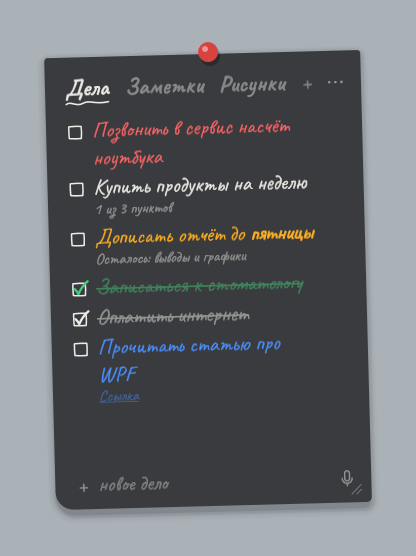
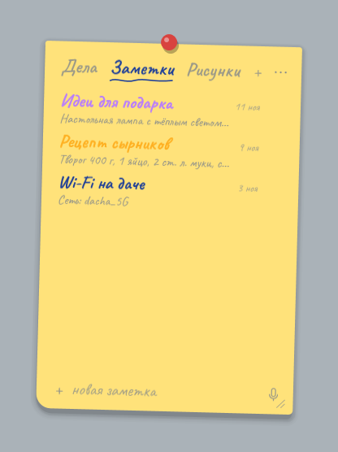
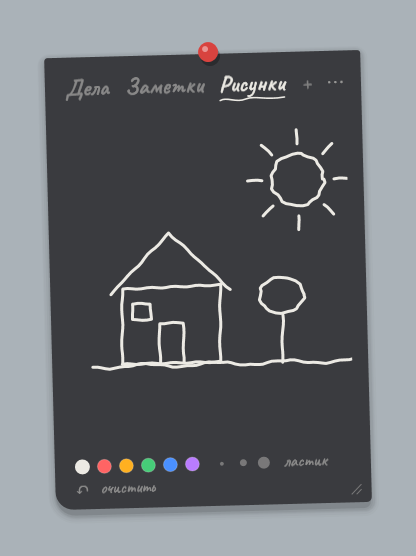

# DeskNotes

Рисованный стикер прямо на рабочем столе Windows: дела, заметки и рисунки от руки. Он всегда под рукой,
никогда не мешает и в простое не тратит ни капли процессора.

<p align="center">
  
  
  
</p>

**[⬇ Скачать DeskNotes-Setup.exe](https://github.com/AFR0D1T/DeskNotes/releases/latest/download/DeskNotes-Setup.exe)** · Windows 10/11 · около 0,5 МБ · без прав администратора

## Что умеет

**Стикер на рабочем столе**
- Живёт на рабочем столе под всеми окнами, как настоящая бумажка.
- **Ctrl+Alt+N** достаёт его поверх всего, **Esc** убирает обратно и возвращает фокус туда, где ты был.
- Нет значка на панели задач и в трее, не попадает в Alt+Tab.
- По умолчанию не виден в записи экрана, на стримах и в демонстрации экрана (можно выключить).

**Дела и заметки**
- Вкладки: списки дел с галочками, заметки, рисунки. «+» добавляет новую, двойной клик переименовывает, правый клик меняет тип, порядок и удаляет.
- Клик по записи раскрывает подробности: текст, подпункты с галочками, дата создания.
- Пять цветных меток. Метка показывается цветным текстом, маркером или точкой, цвета настраиваются.
- Форматирование текста: жирный, курсив, зачёркнутый, подчёркнутый и маркер. Выдели текст и нажми правую кнопку, либо **Ctrl+Shift+X** (зачеркнуть) и **Ctrl+Shift+H** (маркер).
- Ссылки на сайты, файлы и папки открываются по **Ctrl+клику**. Понимает пути `C:\...`, `"C:\Program Files\..."`, `\\сервер\папка`, `%USERPROFILE%\...`. Длинную ссылку можно спрятать под коротким названием.
- Файлы и папки можно перетащить из Проводника прямо на стикер или прикрепить через правый клик → «Прикрепить файл… / папку…».
- Удалил лишнее? **Ctrl+Z** вернёт.

**Голосовой ввод, полностью офлайн**
- Микрофон или **Ctrl+M**. Каждая пауза становится отдельным делом, фраза «Запомни…» уходит в заметки.
- Пауза в 3 секунды, Enter или повторный клик заканчивают диктовку.
- Распознавание работает на твоём компьютере ([Vosk](https://alphacephei.com/vosk/)), в интернет ничего не уходит.

**Рисунки**
- Рисуй мышкой или пером: шесть цветов, три толщины, ластик, «очистить», **Ctrl+Z** отменяет штрих.
- Лёгкое сглаживание линий, его силу можно выбрать.

**Внешний вид (меню ⋯)**
- Бумага: графитовая и школьная доска, ночная, жёлтый стикер, розовый, голубой, мятный, белый лист, крафт или свой цвет.
- Чернила: мел, графит, синяя ручка, коричневые, бордо или свой цвет.
- Почерк: Caveat (ставится вместе с программой), рукописные шрифты Windows или свой `.ttf` в папке `fonts`.
- Размер текста, наклон стикера, тень, крепление (кнопка, скотч, скрепка или без него).

### Горячие клавиши

| Клавиши | Что делают |
|---|---|
| Ctrl+Alt+N | достать стикер / убрать обратно |
| Esc | закрыть подробности, иначе убрать стикер |
| Ctrl+N | к полю новой записи |
| Ctrl+M | голосовой ввод |
| Ctrl+Tab, Ctrl+Shift+Tab | следующая / предыдущая вкладка |
| Ctrl+1 … Ctrl+9 | вкладка по номеру |
| Ctrl+Z | вернуть удалённое, в рисунке отменить штрих |
| Ctrl+клик | открыть ссылку, файл или папку |
| Ctrl+Shift+X / Ctrl+Shift+H | зачеркнуть / выделить маркером |

## Установка

Скачай [DeskNotes-Setup.exe](https://github.com/AFR0D1T/DeskNotes/releases/latest/download/DeskNotes-Setup.exe) из [последнего релиза](https://github.com/AFR0D1T/DeskNotes/releases/latest) и запусти.

- Права администратора не нужны, программа ставится в `%LOCALAPPDATA%\Programs\DeskNotes`.
- Галочки: голосовой ввод (скачает около 60 МБ для офлайн-распознавания, файлы проверяются по контрольной сумме), автозапуск, ярлык в «Пуске».
- Повторный запуск установщика обновляет программу, записи при этом не трогаются.
- Удаление: «Параметры → Приложения → DeskNotes → Удалить». Установщик спросит, удалять ли записи.
- Установка без окна: `DeskNotes-Setup.exe /silent [/novoice] [/noautostart] [/nomenu]`.

У установщика нет цифровой подписи, поэтому Windows SmartScreen может предупредить о неизвестном издателе. Нажми «Подробнее → Выполнить в любом случае».

## Нагрузка на компьютер

Главное требование к DeskNotes: стикер висит весь день, а компьютер этого не замечает. Цифры ниже измерены
автоматически: [`tools/screenshots.ps1`](tools/screenshots.ps1) запускает программу на чистой Windows в GitHub Actions
и минуту наблюдает за ней в простое.

| | |
|---|---|
| Процессор в простое | **0 мс за 60 секунд** (ровно ноль) |
| Память (личная) | около 37 МБ |
| Память в Диспетчере задач (рабочий набор) | около 22 МБ |
| Видеокарта | не используется совсем |
| Диск в простое | ни одной записи |
| Приоритет в фоне | самый низкий (Idle) + «режим эффективности» Windows 11 |
| Размер программы | 116 КБ, один `.exe` |
| Запуск | около 0,3 с на обычном компьютере |

### Как это сделано

**Ничего не происходит, пока ты ничего не делаешь**
- Нет таймеров, опросов и анимаций в фоне. Программа просыпается только на события: нажатие клавиш, клик, горячая клавиша.
- Свёрнутый стикер переходит на самый низкий приоритет и в «режим эффективности» (EcoQoS) Windows 11, поэтому никогда не конкурирует с играми, браузером или работой. Когда стикер открываешь, приоритет становится обычным, и набор текста не тормозит.
- Отдельный поток для фоновой сборки мусора .NET отключён: для стикера он не нужен, и в процессе на один поток меньше.

**Дешёвая отрисовка**
- Отрисовка только программная, видеокарта не используется вообще: стикер не будит GPU и не мешает играм.
- Тень бумаги собрана из нескольких полупрозрачных слоёв, а не из эффекта размытия. Размытие при программной отрисовке пересчитывалось бы на каждое нажатие клавиши, а слои почти ничего не стоят.
- Фигуры (галочки, рамки, подчёркивания) и кисти создаются один раз и переиспользуются. Контекстные меню собираются, только когда их действительно открывают.

**Диск: только когда нужно**
- Сохранение откладывается на 0,7 секунды после последнего изменения, а не происходит на каждую букву. Если ничего не менялось, на диск не пишется ничего.
- Рисунок кодируется один раз, прямо перед сохранением, а не после каждого штриха.
- Файл записывается целиком во временный и потом подменяет старый, поэтому записи не испортятся, даже если выключится свет.

**Память**
- Модель распознавания речи (около 400 МБ в памяти) загружается только при нажатии на микрофон и выгружается через минуту после диктовки. Поток записи существует, только пока идёт запись.
- После запуска и после диктовки неиспользуемая память возвращается системе. При каждом сворачивании этого не делается специально, иначе следующее Ctrl+Alt+N открывалось бы медленнее.

**Никаких неожиданных задержек**
- Распознавание ссылок в тексте никогда не обращается к сетевым дискам и путям `\\сервер\...`: медленный или выключенный сервер не может подвесить стикер.
- Проверки существования файлов кэшируются, шрифты проверяются точечно, без перебора всех установленных.
- Состояние автозапуска запоминается, а не спрашивается у Планировщика заданий при каждом открытии меню.

**Быстрый старт**
- Автозапуск идёт через Планировщик заданий «при входе в систему», а не через список «Run», который Windows запускает с задержкой. Стикер появляется вместе с рабочим столом.
- Программа написана на C# под .NET Framework 4.8, который уже встроен в Windows 10/11. Ничего не нужно доустанавливать, нет тяжёлого встроенного браузера (как в Electron), и весь стикер помещается в 116 КБ.
- Повторный запуск не создаёт вторую копию.

## Где хранятся записи

`%APPDATA%\DeskNotes`:
- `data.json` — вкладки, дела, заметки и рисунки;
- `settings.json` — внешний вид, положение и размер стикера;
- `fonts\` — шрифты для почерка (сюда можно положить свой `.ttf`);
- `vosk\` — голосовой ввод, если он установлен.

Открыть эту папку можно из меню ⋯ → «Открыть папку с данными». Перед обновлением через `build.ps1 -Install` делается копия `data.backup.json`.

## Сборка из исходников

Нужна только Windows 10/11: компилятор C# уже есть в системе, ставить ничего не надо.

```powershell
.\build.ps1            # собрать bin\DeskNotes.exe и bin\DeskNotes-Setup.exe
.\build.ps1 -Install   # собрать и заменить установленную копию
.\build.ps1 -Release   # собрать и выложить установщик в GitHub Releases (нужен gh)
```

Новую версию можно выпустить и без своего компьютера: поменяй номер версии в `installer/Setup.cs` и `DeskNotes.cs`, затем открой вкладку **Actions → Release → Run workflow**. GitHub соберёт установщик на Windows и опубликует релиз.

Скриншоты в этом README обновляются через **Actions → Screenshots → Run workflow**: программа запускается с демо-записями, а картинки и замеры попадают в ветку `screenshots`.

### Что где лежит

| Файл | Что это |
|---|---|
| `DeskNotes.cs` | вся программа, один файл |
| `installer/Setup.cs` | установщик и удаление |
| `build.ps1` | сборка, установка, релиз |
| `assets/` | иконка и шрифт Caveat |
| `tools/screenshots.ps1` | скриншоты и замеры нагрузки на демо-данных |
| `tools/measure-startup.ps1` | замер времени запуска на своём компьютере |
| `tools/make-icon.ps1` | рисует иконку `assets/icon.ico` |
| `docs/` | скриншоты для README |

## Сторонние компоненты

- Шрифт [Caveat](https://github.com/googlefonts/caveat), лицензия SIL Open Font License 1.1 (`assets/fonts/OFL.txt`).
- Голосовой ввод: [Vosk](https://alphacephei.com/vosk/) и модель `vosk-model-small-ru-0.22` (Apache 2.0). Скачиваются установщиком и в репозиторий не входят.
