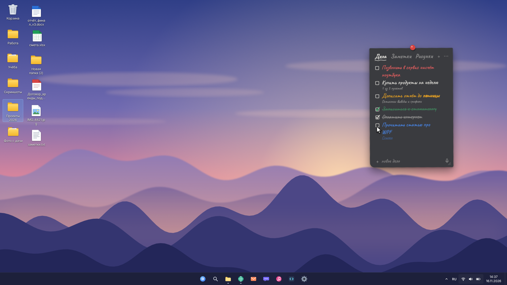
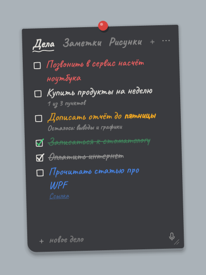
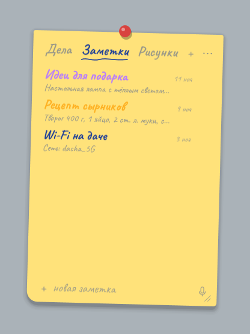
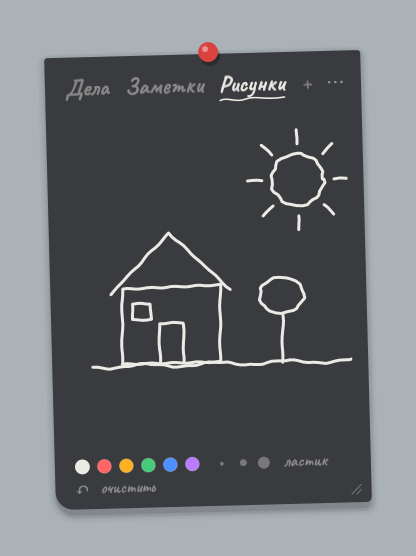
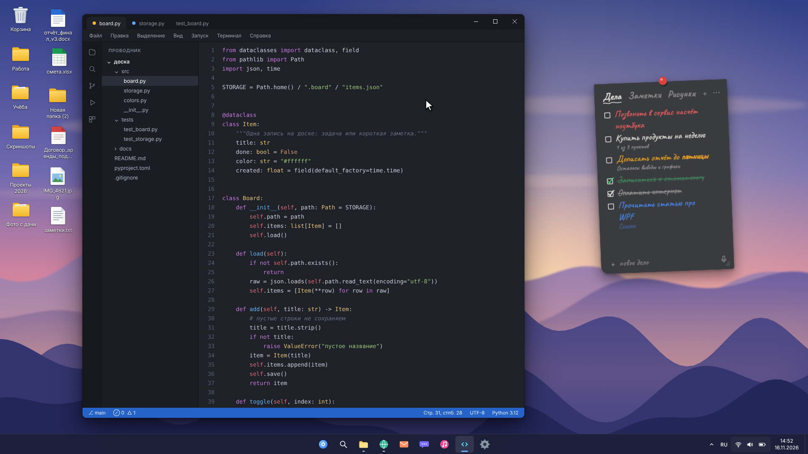
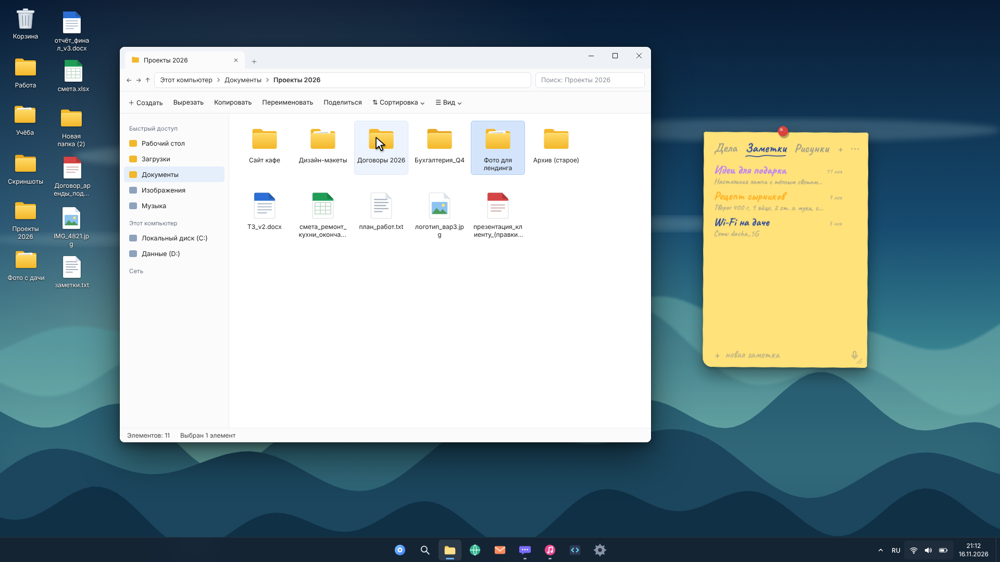
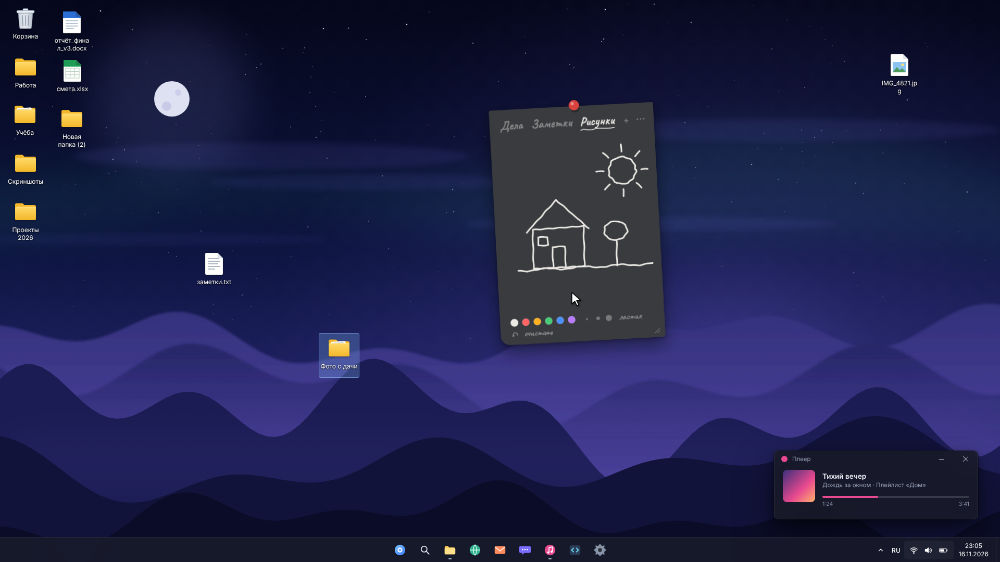

# DeskNotes

[Русский](README.ru.md) · **English**

<p align="center">
  
</p>

<p align="center">
  
  
  
</p>

<details>
<summary>What it looks like in use</summary>





</details>

A small sticky note for the Windows desktop: to-dos, notes and hand drawings.

Made it for myself. I wanted a plain piece of paper on the desktop, so I could jot something down and not lose it among ten browser tabs. Everything I found either dragged a whole browser along (hi, Electron) or sat in the tray doing something all the time. A sticky that eats CPU while idle annoyed me most. So I wrote my own: one `.exe`, 116 KB, 0 ms of CPU when idle. I didn't believe it either, so the measurements are below.

**[Download DeskNotes-Setup.exe](https://github.com/AFR0D1T/DeskNotes/releases/latest/download/DeskNotes-Setup.exe)** · Windows 10/11 · about 0.5 MB · no admin rights needed

## What it does

The sticky lives on the desktop under all other windows, like a real piece of paper. **Ctrl+Alt+N** pulls it up on top of everything, **Esc** sends it back and returns focus to where you were. It's not on the taskbar, not in the tray, not in Alt+Tab. In screen recordings and streams it's hidden by default (you can turn that off).

Inside there are tabs of three kinds: to-do lists with checkboxes, notes and drawings. "+" adds a new one, double click renames, right click changes the type, the order, and deletes. Click an item to expand it: text, subitems, creation date. There are five color labels (colored text, highlighter or a dot, and you can change the colors). Deleted something by mistake? **Ctrl+Z** brings it back.

You can do a few things with text:
- bold, italic, strikethrough, underline and highlighter: select the text and right click, or use **Ctrl+Shift+X** (strikethrough) and **Ctrl+Shift+H** (highlighter);
- links to websites, files and folders open with **Ctrl+click**; it understands paths like `C:\...`, `"C:\Program Files\..."`, `\\server\folder`, `%USERPROFILE%\...`, and a long link can be hidden behind a short title;
- drag a file or folder from Explorer straight onto the sticky, or attach it with right click → "Attach file… / folder…".

Voice input works fully offline. Click the microphone or press **Ctrl+M** and dictate: every pause becomes a separate to-do, and the phrase «Запомни…» ("Remember…") sends what follows to notes. To finish, pause for 3 seconds, press Enter or click again. Recognition is done by [Vosk](https://alphacephei.com/vosk/) right on your computer, nothing goes to the internet. One catch: right now it uses the Russian model (`vosk-model-small-ru-0.22`), so it recognizes Russian speech, and that's also why the trigger phrase is in Russian.

You can draw with a mouse or a pen: six colors, three thicknesses, an eraser, "clear", and **Ctrl+Z** undoes a stroke. Lines get smoothed a little, and you can pick how much.

Looks are configured in the ⋯ menu:
- paper: graphite and school chalkboard, night, yellow sticky, pink, light blue, mint, white sheet, kraft or your own color;
- ink: chalk, graphite, blue pen, brown, burgundy or your own color;
- handwriting: Caveat (installed with the program), Windows handwriting fonts or your own `.ttf` in the `fonts` folder;
- text size, tilt of the sticky, shadow and attachment (button, tape, paper clip or none).

### Hotkeys

| Keys | What they do |
|---|---|
| Ctrl+Alt+N | pull up the sticky / put it back |
| Esc | close the details, otherwise put the sticky away |
| Ctrl+N | jump to the new item field |
| Ctrl+M | voice input |
| Ctrl+Tab, Ctrl+Shift+Tab | next / previous tab |
| Ctrl+1 … Ctrl+9 | tab by number |
| Ctrl+Z | restore deleted items, undo a stroke in a drawing |
| Ctrl+click | open a link, file or folder |
| Ctrl+Shift+X / Ctrl+Shift+H | strikethrough / highlighter |

## Installation

Download [DeskNotes-Setup.exe](https://github.com/AFR0D1T/DeskNotes/releases/latest/download/DeskNotes-Setup.exe) from the [latest release](https://github.com/AFR0D1T/DeskNotes/releases/latest) and run it.

- No admin rights needed, it installs to `%LOCALAPPDATA%\Programs\DeskNotes`.
- The installer has three checkboxes: voice input (downloads about 60 MB for offline recognition, files are verified by checksum), autostart and a Start menu shortcut.
- Running the installer again updates the program. Your notes are not touched.
- To remove it, go to Settings → Apps → DeskNotes → Uninstall. The installer will ask whether to delete your notes.
- Silent install: `DeskNotes-Setup.exe /silent [/novoice] [/noautostart] [/nomenu]`.

The installer isn't digitally signed, so SmartScreen may complain about an unknown publisher. Click "More info → Run anyway".

## Why it doesn't eat resources

I didn't make these numbers up. [`tools/screenshots.ps1`](tools/screenshots.ps1) launches the program on a clean Windows machine in GitHub Actions and watches what it does while idle for a minute.

| | |
|---|---|
| CPU when idle | 0 ms in 60 seconds (exactly zero) |
| Memory (private) | about 37 MB |
| Memory in Task Manager (working set) | about 22 MB |
| GPU | not used at all |
| Disk when idle | no writes |
| Background priority | lowest (Idle) + Windows 11 "efficiency mode" |
| Program size | 116 KB, a single `.exe` |
| Startup | about 0.3 s on an ordinary computer |

How it came out that way, in short:

- **While you do nothing, nothing happens.** No timers, no polling, no background animations. The program wakes up only on an event: a key, a click, a hotkey.
- **A minimized sticky drops to the lowest priority** and into Windows 11 "efficiency mode" (EcoQoS), so it doesn't compete with games or the browser. When you open the sticky, the priority goes back to normal so typing doesn't lag.
- **It draws on the CPU, no GPU needed at all.** The paper shadow is built from several semi-transparent layers instead of a blur: with software rendering a blur would be recalculated on every keypress. Brushes and shapes are created once, context menus are built only when opened.
- **Disk writes are rare.** Saving is delayed by 0.7 seconds after the last edit, and if nothing changed, nothing is written. A drawing is encoded once before saving, not after every stroke. The file is written to a temporary one and then replaces the old one, so your notes survive even if the power goes out.
- **The speech recognition model** takes about 400 MB of memory, so it's loaded only when you click the microphone and unloaded a minute after dictation. The recording thread also lives only while recording.
- **No spare memory hanging around.** After startup and after dictation it's handed back to the system. I deliberately don't do this on every minimize: otherwise the next Ctrl+Alt+N would open more slowly.
- **Nothing to hang the sticky on.** Links in the text are not checked on network drives and `\\server\...` paths, so a switched-off server won't freeze it. File existence checks are cached, and the autostart state is remembered instead of asking Task Scheduler every time the menu opens.
- **Starts fast.** Autostart goes through Task Scheduler "at log on", not through the "Run" list, which Windows launches with a delay. A second instance is never created.
- **Written in C# on .NET Framework 4.8**, which is already built into Windows 10/11, so there's nothing to install. No embedded browser, hence the 116 KB. I turned off the separate background garbage collection thread of .NET: the sticky doesn't need it, and that's one thread less.

## Where your notes are stored

In `%APPDATA%\DeskNotes`:
- `data.json`: tabs, to-dos, notes and drawings;
- `settings.json`: looks, position and size of the sticky;
- `fonts\`: handwriting fonts (put your own `.ttf` here);
- `vosk\`: voice input, if installed.

You can open the folder from the ⋯ menu → "Open data folder". Before an update via `build.ps1 -Install`, a copy `data.backup.json` is made.

## Building from source

You only need Windows 10/11: the C# compiler is already in the system, nothing to install.

```powershell
.\build.ps1            # build bin\DeskNotes.exe and bin\DeskNotes-Setup.exe
.\build.ps1 -Install   # build and replace the installed copy
.\build.ps1 -Release   # build and publish the installer to GitHub Releases (needs gh)
```

A new version can also be released without my computer: change the version number in `installer/Setup.cs` and `DeskNotes.cs`, then open **Actions → Release → Run workflow**. GitHub builds the installer on Windows and publishes the release.

The pictures in the README and the load measurements are updated via **Actions → Screenshots → Run workflow**: the program is launched with demo notes, and the results land in the `screenshots` branch.

### What's where

| File | What it is |
|---|---|
| `DeskNotes.cs` | the whole program, one file |
| `installer/Setup.cs` | installer and uninstaller |
| `build.ps1` | build, install, release |
| `assets/` | icon and the Caveat font |
| `tools/screenshots.ps1` | screenshots and load measurements on demo data |
| `tools/measure-startup.ps1` | startup time measurement on your own computer |
| `tools/make-icon.ps1` | draws the icon `assets/icon.ico` |
| `docs/` | pictures for the README |

## Third-party components

- The [Caveat](https://github.com/googlefonts/caveat) font, SIL Open Font License 1.1 (`assets/fonts/OFL.txt`).
- Voice input: [Vosk](https://alphacephei.com/vosk/) and the `vosk-model-small-ru-0.22` model (Apache 2.0), which is a Russian-language model. Downloaded by the installer and not included in the repository.
