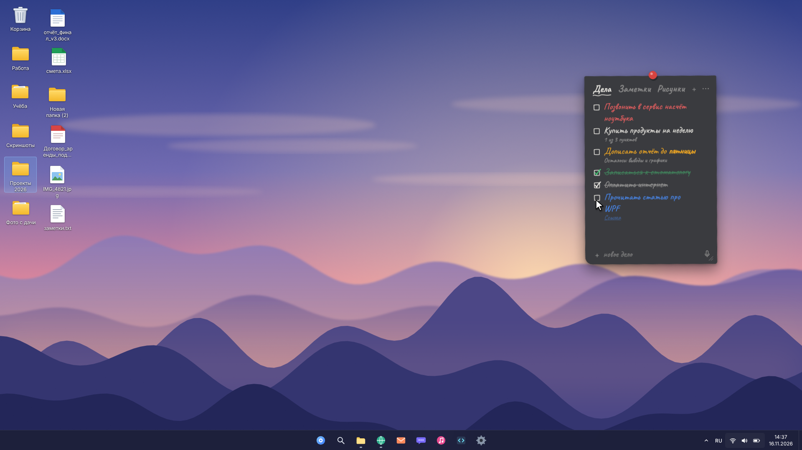
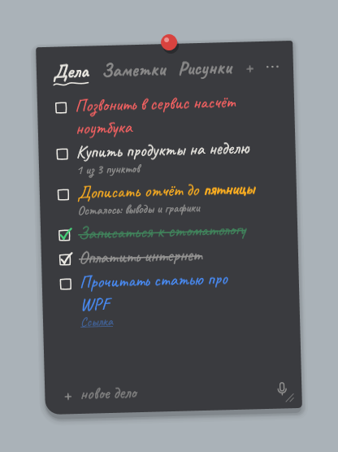
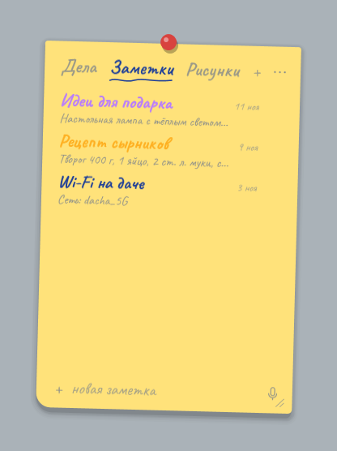
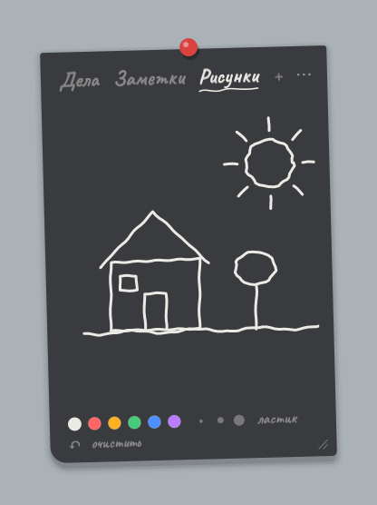
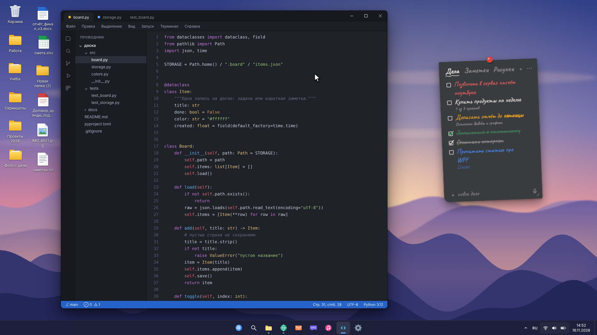
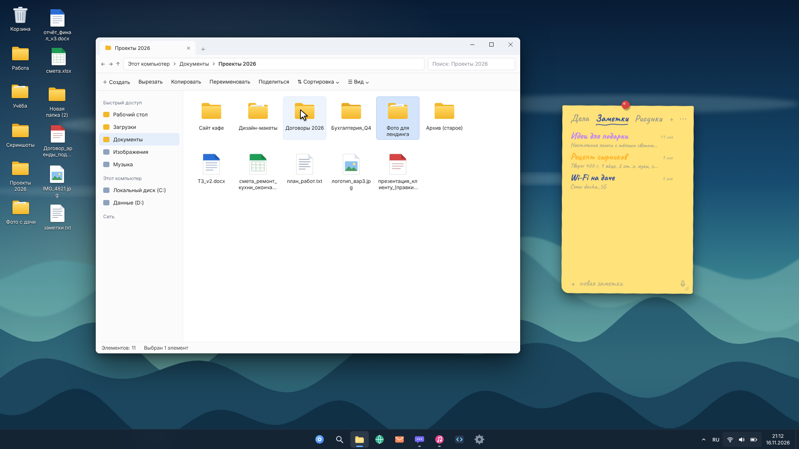
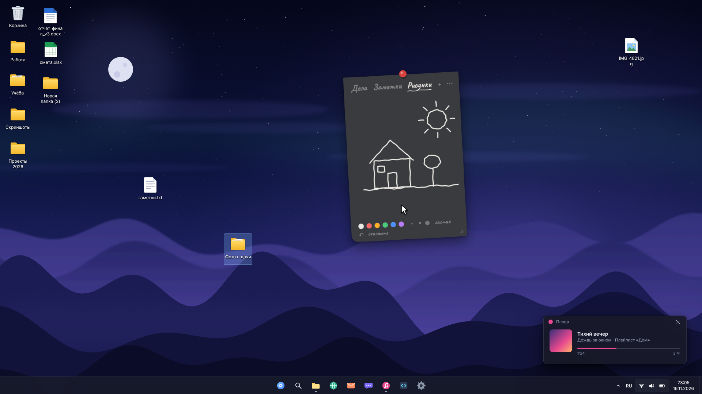

# DeskNotes

**Русский** · [English](README.md)

<p align="center">
  
</p>

<p align="center">
  
  
  
</p>

<details>
<summary>Как это выглядит в работе</summary>





</details>

Маленький стикер для рабочего стола Windows: дела, заметки и рисунки от руки.

Сделал для себя. Мне нужна была обычная бумажка на рабочем столе, чтобы записать дело и не потерять его в десятке вкладок. Всё, что я находил, либо тянуло за собой целый браузер (привет, Electron), либо жило в трее и что-то там постоянно делало. Стикер, который в простое грузит процессор, бесил особенно. В итоге написал свой: один `.exe` на 116 КБ, в простое 0 мс процессора. Не поверил сам, поэтому ниже есть замеры.

**[Скачать DeskNotes-Setup.exe](https://github.com/AFR0D1T/DeskNotes/releases/latest/download/DeskNotes-Setup.exe)** · Windows 10/11 · около 0,5 МБ · права администратора не нужны

## Что умеет

Стикер лежит на рабочем столе под всеми окнами, как настоящая бумажка. **Ctrl+Alt+N** достаёт его поверх всего, **Esc** убирает обратно и возвращает фокус туда, где ты был. В панели задач и трее его нет, в Alt+Tab тоже. В записи экрана и на стримах он по умолчанию не виден (если нужно, это выключается).

Внутри вкладки трёх типов: списки дел с галочками, заметки и рисунки. «+» добавляет новую, двойной клик переименовывает, правый клик меняет тип, порядок и удаляет. Клик по записи раскрывает её: текст, подпункты, дата создания. Есть пять цветных меток (цветной текст, маркер или точка, цвета можно поменять). Удалил лишнее по ошибке? **Ctrl+Z** вернёт.

С текстом можно делать всякое:
- жирный, курсив, зачёркнутый, подчёркнутый и маркер: выдели текст и нажми правую кнопку, либо **Ctrl+Shift+X** (зачеркнуть) и **Ctrl+Shift+H** (маркер);
- ссылки на сайты, файлы и папки открываются по **Ctrl+клику**; понимает пути вида `C:\...`, `"C:\Program Files\..."`, `\\сервер\папка`, `%USERPROFILE%\...`, а длинную ссылку можно спрятать под коротким названием;
- файл или папку можно перетащить из Проводника прямо на стикер или прикрепить через правый клик → «Прикрепить файл… / папку…».

Голосовой ввод работает полностью офлайн. Нажми на микрофон или **Ctrl+M** и диктуй: каждая пауза становится отдельным делом, а фраза «Запомни…» уходит в заметки. Закончить можно паузой в 3 секунды, Enter или повторным кликом. Распознаёт [Vosk](https://alphacephei.com/vosk/) прямо на твоём компьютере, в интернет ничего не уходит.

Рисовать можно мышкой или пером: шесть цветов, три толщины, ластик, «очистить», а **Ctrl+Z** отменяет штрих. Линии слегка сглаживаются, силу сглаживания можно выбрать.

Внешний вид настраивается в меню ⋯:
- бумага: графитовая и школьная доска, ночная, жёлтый стикер, розовый, голубой, мятный, белый лист, крафт или свой цвет;
- чернила: мел, графит, синяя ручка, коричневые, бордо или свой цвет;
- почерк: Caveat (ставится вместе с программой), рукописные шрифты Windows или свой `.ttf` в папке `fonts`;
- размер текста, наклон стикера, тень и крепление (кнопка, скотч, скрепка или без него).

### Горячие клавиши

| Клавиши | Что делают |
|---|---|
| Ctrl+Alt+N | достать стикер / убрать обратно |
| Esc | закрыть подробности, иначе убрать стикер |
| Ctrl+N | к полю новой записи |
| Ctrl+M | голосовой ввод |
| Ctrl+Tab, Ctrl+Shift+Tab | следующая / предыдущая вкладка |
| Ctrl+1 … Ctrl+9 | вкладка по номеру |
| Ctrl+Z | вернуть удалённое, в рисунке отменить штрих |
| Ctrl+клик | открыть ссылку, файл или папку |
| Ctrl+Shift+X / Ctrl+Shift+H | зачеркнуть / выделить маркером |

## Установка

Скачай [DeskNotes-Setup.exe](https://github.com/AFR0D1T/DeskNotes/releases/latest/download/DeskNotes-Setup.exe) из [последнего релиза](https://github.com/AFR0D1T/DeskNotes/releases/latest) и запусти.

- Права администратора не нужны, ставится в `%LOCALAPPDATA%\Programs\DeskNotes`.
- В установщике три галочки: голосовой ввод (скачает около 60 МБ для офлайн-распознавания, файлы проверяются по контрольной сумме), автозапуск и ярлык в «Пуске».
- Если запустить установщик ещё раз, он обновит программу. Записи при этом не трогаются.
- Удалить можно через «Параметры → Приложения → DeskNotes → Удалить». Установщик спросит, стирать ли записи.
- Установка без окна: `DeskNotes-Setup.exe /silent [/novoice] [/noautostart] [/nomenu]`.

Цифровой подписи у установщика нет, поэтому SmartScreen может ругнуться на неизвестного издателя. Жми «Подробнее → Выполнить в любом случае».

## Почему он не ест ресурсы

Цифры ниже я не выдумывал. [`tools/screenshots.ps1`](tools/screenshots.ps1) запускает программу на чистой Windows в GitHub Actions и минуту смотрит, что она делает в простое.

| | |
|---|---|
| Процессор в простое | 0 мс за 60 секунд (ровно ноль) |
| Память (личная) | около 37 МБ |
| Память в Диспетчере задач (рабочий набор) | около 22 МБ |
| Видеокарта | не используется совсем |
| Диск в простое | ни одной записи |
| Приоритет в фоне | самый низкий (Idle) + «режим эффективности» Windows 11 |
| Размер программы | 116 КБ, один `.exe` |
| Запуск | около 0,3 с на обычном компьютере |

Как так получилось, если коротко:

- **Пока ты ничего не делаешь, ничего не происходит.** Ни таймеров, ни опросов, ни фоновых анимаций. Программа просыпается только от события: клавиша, клик, горячая клавиша.
- **Свёрнутый стикер уходит на самый низкий приоритет** и в «режим эффективности» (EcoQoS) Windows 11, так что с играми и браузером он не конкурирует. Когда открываешь стикер, приоритет возвращается к обычному, чтобы текст не тормозил.
- **Рисуется на процессоре, видеокарта вообще не нужна.** Тень бумаги собрана из нескольких полупрозрачных слоёв, а не размытием: при программной отрисовке размытие пересчитывалось бы на каждое нажатие клавиши. Кисти и фигуры создаются один раз, контекстные меню строятся, только когда их открыли.
- **На диск пишется редко.** Сохранение откладывается на 0,7 секунды после последней правки, и если ничего не менялось, не пишется ничего. Рисунок кодируется один раз перед сохранением, а не после каждого штриха. Файл пишется во временный и потом подменяет старый, так что записи не пропадут, даже если вырубится свет.
- **Модель распознавания речи** занимает около 400 МБ в памяти, поэтому грузится только по клику на микрофон и выгружается через минуту после диктовки. Поток записи тоже живёт только во время записи.
- **Лишней памяти нет.** После запуска и после диктовки она возвращается системе. При каждом сворачивании этого не делаю нарочно: иначе следующий Ctrl+Alt+N открывался бы медленнее.
- **Подвесить стикер нечем.** Ссылки в тексте не проверяются на сетевых дисках и путях `\\сервер\...`, поэтому выключенный сервер его не заморозит. Проверки существования файлов кэшируются, а состояние автозапуска запоминается, а не спрашивается у Планировщика при каждом открытии меню.
- **Стартует быстро.** Автозапуск идёт через Планировщик заданий «при входе в систему», а не через список «Run», который Windows запускает с задержкой. Второй экземпляр не создаётся.
- **Написан на C# под .NET Framework 4.8**, он уже встроен в Windows 10/11, ничего доустанавливать не надо. Встроенного браузера нет, отсюда и 116 КБ. Отдельный поток фоновой сборки мусора .NET я отключил: стикеру он не нужен, а потоком меньше.

## Где хранятся записи

В `%APPDATA%\DeskNotes`:
- `data.json`: вкладки, дела, заметки и рисунки;
- `settings.json`: внешний вид, положение и размер стикера;
- `fonts\`: шрифты для почерка (сюда можно положить свой `.ttf`);
- `vosk\`: голосовой ввод, если он установлен.

Открыть папку можно из меню ⋯ → «Открыть папку с данными». Перед обновлением через `build.ps1 -Install` делается копия `data.backup.json`.

## Сборка из исходников

Нужна только Windows 10/11: компилятор C# в системе уже есть, ничего ставить не надо.

```powershell
.\build.ps1            # собрать bin\DeskNotes.exe и bin\DeskNotes-Setup.exe
.\build.ps1 -Install   # собрать и заменить установленную копию
.\build.ps1 -Release   # собрать и выложить установщик в GitHub Releases (нужен gh)
```

Новую версию можно выпустить и без своего компьютера: поменяй номер версии в `installer/Setup.cs` и `DeskNotes.cs`, затем открой **Actions → Release → Run workflow**. GitHub соберёт установщик на Windows и опубликует релиз.

Картинки в README и замеры нагрузки обновляются через **Actions → Screenshots → Run workflow**: программа запускается с демо-записями, результаты попадают в ветку `screenshots`.

### Что где лежит

| Файл | Что это |
|---|---|
| `DeskNotes.cs` | вся программа, один файл |
| `installer/Setup.cs` | установщик и удаление |
| `build.ps1` | сборка, установка, релиз |
| `assets/` | иконка и шрифт Caveat |
| `tools/screenshots.ps1` | скриншоты и замеры нагрузки на демо-данных |
| `tools/measure-startup.ps1` | замер времени запуска на своём компьютере |
| `tools/make-icon.ps1` | рисует иконку `assets/icon.ico` |
| `docs/` | картинки для README |

## Сторонние компоненты

- Шрифт [Caveat](https://github.com/googlefonts/caveat), лицензия SIL Open Font License 1.1 (`assets/fonts/OFL.txt`).
- Голосовой ввод: [Vosk](https://alphacephei.com/vosk/) и модель `vosk-model-small-ru-0.22` (Apache 2.0). Скачиваются установщиком и в репозиторий не входят.
